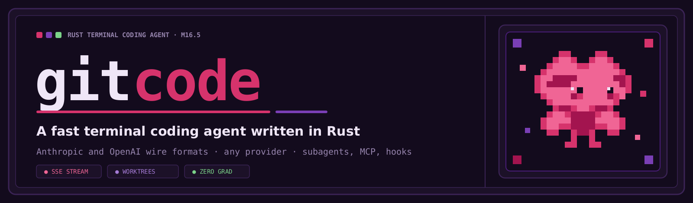
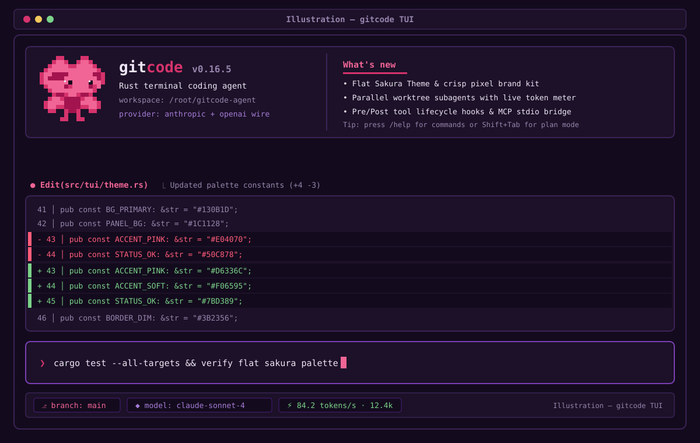

<div align="center">



[](Cargo.toml)
[](docs/dev/COMPLIANCE-AUDIT.md)
[](LICENSE)

[Scope](#current-scope) · [Run](#run-from-source) · [Providers](#provider-endpoints) · [Safety](#safety-and-limitations) · [Development](#development)

</div>

# gitcode

A local-first terminal coding agent under development in a single Rust Cargo package. The current executable runs a bounded model/tool loop over Anthropic Messages, OpenAI Chat Completions, or OpenAI Responses, with workspace editing and shell tools behind a permission engine.

> [!NOTE]
> Full Claude Code / Codex workflow parity is a development target, **not a current feature claim**. The [compliance audit](docs/dev/COMPLIANCE-AUDIT.md) distinguishes helper modules from working executable behavior and records missing acceptance checks.

## Current scope

| Area | Current implementation | Important limitations |
| --- | --- | --- |
| Provider transport | Three HTTP/SSE adapters, fragmented-stream fixtures and local TCP mock tests | Advanced reasoning replay, registry options and resilience acceptance are incomplete |
| Agent | Model -> validated tools -> tool results -> model loop | Parallel tool scheduling and cancellation-consistent persistence remain incomplete |
| Workspace tools | Read, LS, Glob, Grep, Write, Edit, MultiEdit, NotebookEdit, apply_patch | Text-oriented reads; no complete image/PDF tool path |
| Editing | Read-before-write tracking and per-file atomic replacement | Multi-file changes are not crash-atomic; checkpoints/diffs are not integrated automatically |
| Shell | Persistent non-interactive sessions and background-job helpers | No OS-level sandbox; restrictive parser rejects unsupported syntax |
| Terminal | Framed Sakura header and prompt, immediate slash popup, tabbed usage, model picker, live retry/tool progress, Unicode editor and streaming Markdown | Advanced completion, persistent history and permission approval remain incomplete |
| Headless | `-p`, `exec`, bounded stdin, text/JSON and live stream-JSON output, doctor and completions | Stream input accepts text/message.content strings; full flags/tool-event parity remains incomplete |
| Sessions and usage | Completed CLI/TUI turns persist, `--resume`/`--continue`, project memory, per-request usage ledger | Failed/interrupted turns are not committed; prices remain unknown and USD budgets fail closed |
| Other modules | Checkpoints, agency, commands, hooks, skills, MCP and web helpers | Module presence does not mean these are available in the interactive application |

## What it looks like



*Design illustration, not a captured application screenshot. Some illustrated functionality remains unintegrated.*

## Windows port and installers (pending validation)

The native Windows port and per-user installers are being validated on `feat/windows`. Windows support is not a published feature until native Windows CI and installer smoke jobs pass. See [Windows requirements and limitations](docs/windows.md) and [static installer deployment](docs/dev/DEPLOY-INSTALLER.md).

The custom-domain installer endpoint is not live (manifest check returned HTTP 404). Once a release containing these scripts is verified and merged, the GitHub-hosted installation paths are:

```bash
export GITCODE_BASE_URL=https://github.com/jaddd14/gitcode-agent/releases/latest/download
curl -fsSL https://raw.githubusercontent.com/jaddd14/gitcode-agent/main/scripts/install.sh | bash
```

```powershell
$env:GITCODE_BASE_URL = 'https://github.com/jaddd14/gitcode-agent/releases/latest/download'
irm https://raw.githubusercontent.com/jaddd14/gitcode-agent/main/scripts/install.ps1 | iex
```

These are pending publication, not currently verified installation commands. Installers use SHA256 verification and require no administrator rights. A verified installation can later be updated with `gitcode update`.

## Run from source

Use Rust 1.99, the installed toolchain used during development. Older Rust versions have not been verified.

```bash
cargo build --release
./target/release/gitcode --help
./target/release/gitcode --version
./target/release/gitcode
```

A configured reachable provider is needed for model requests; startup itself does not request model output.

```bash
export ANTHROPIC_API_KEY="<your-key>"
./target/release/gitcode -p "Inspect src/lib.rs and summarize the module boundaries"
```

[Release v0.1.0](https://github.com/jaddd14/gitcode-agent/releases/tag/v0.1.0) provides Linux x86_64 and macOS arm64 archives plus SHA256SUMS. Linux/macOS CI, Security, staging and release passed for `b3aca36`. This initial speed-first release retains the documented limitations; it does not claim full workflow parity.

## Provider endpoints

The executable currently accepts explicit endpoint/protocol overrides. Set an API key locally; never commit it.

```bash
./target/release/gitcode --protocol anthropic --base-url https://api.anthropic.com -p "Hello"
./target/release/gitcode --protocol openai-chat --base-url https://api.openai.com/v1 -p "Hello"
./target/release/gitcode --protocol openai-responses --base-url https://api.openai.com/v1 -p "Hello"
```

Credential environment-variable selection follows the configured `provider.api_key_env`; changing a wire protocol alone does not change that variable. Configure it explicitly for non-Anthropic endpoints.

The `src/provider/registry.rs` preset list and quirk transformer are library components; a complete live-selectable provider/model registry is not yet available. Do not assume `--provider` selects a preset until its runtime integration is verified.

## Safety and limitations

- Permission modes and deny/ask/allow rules are implemented in the library. The interactive approval flow is not complete: operations requiring approval fail closed.
- `--dangerously-skip-permissions` enables bypass behavior; explicit denial rules and parser restrictions still apply. This flag is not filesystem isolation.
- Native file tools check workspace boundaries. Arbitrary shell commands are **not confined by an OS sandbox**.
- File and web content must be treated as untrusted input. This does not eliminate prompt-injection risk.
- Shell substitutions, redirections and other unsupported syntax may be rejected rather than evaluated.
- Cancellation, secret handling and concurrent-file race protection require continued hardening; see [SECURITY.md](SECURITY.md).

## Configuration

Configuration precedence is defaults < user `~/.gitcode/config.toml` < project `.gitcode/config.toml` < local `.gitcode/config.local.toml` < environment < applicable CLI overrides. The schema is in `src/config.rs`; unsupported keys fail validation.

The product defaults to Russian replies. Source code, development documentation and commit messages use English.

## Development

```bash
./scripts/check.sh
```

The quality gate runs formatting, strict Clippy and tests. Provider tests use local TCP mock servers and SSE fixtures under `testdata/`; they do not require real API credentials. Historical passing test counts do not certify current uncommitted changes.

- [Compliance audit](docs/dev/COMPLIANCE-AUDIT.md): milestone-by-milestone gaps and evidence.
- [Progress](docs/dev/PROGRESS.md): historical checks and current development state.
- [Decisions](docs/dev/DECISIONS.md): engineering choices and limitations.
- [Architecture](docs/dev/ARCHITECTURE.md): module boundaries.
- [Contributing](CONTRIBUTING.md), [Security](SECURITY.md), [Code of conduct](CODE_OF_CONDUCT.md).
- Guides: [configuration](docs/configuration.md), [providers](docs/providers.md), [permissions](docs/permissions.md), [headless](docs/headless.md), [usage](docs/usage-and-cost.md).
- Integrations: [skills](docs/skills.md), [hooks](docs/hooks.md), [MCP](docs/mcp.md), [agency](docs/subagents.md); [troubleshooting](docs/troubleshooting.md).

## Performance

Measured on Linux 6.8, aarch64, Rust 1.99.0, using a freshly rebuilt release executable on 2026-11-08:

| Measurement | Result |
| --- | --- |
| Executable size | 5,289,176 bytes (5.04 MiB) |
| Warm-cache `--version`, 10 launches | 2.20 ms average |
| Warm-cache `--help`, 10 launches | 1.70 ms average |
| Peak RSS of `--version` | 3,456 KiB (3.38 MiB) |

Reproduce with `bash scripts/bench.sh`. These are process-launch measurements, **not** first-painted-frame, active-session memory, idle CPU or streaming frame latency. Those budgets and long-duration soak coverage remain unverified.

## License and acknowledgements

[MIT](LICENSE), copyright 2026 jaddd14. Built in an AI pair-programming workflow; repository authorship and publication remain subject to the final history audit.
