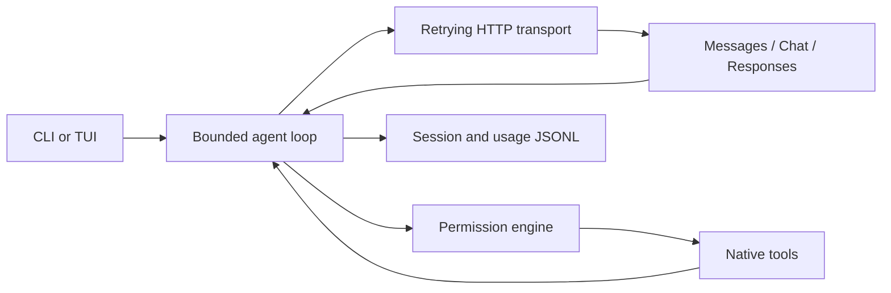

# Architecture

One Cargo package exposes a library and executable. `main` resolves config/auth/session state; CLI and TUI share the bounded agent loop. Provider adapters translate canonical requests/events; tools enforce permissions before workspace or external operations. Session and usage stores persist completed turns.

See [development architecture](dev/ARCHITECTURE.md), [providers](providers.md), [permissions](permissions.md), and [known gaps](dev/PROGRESS.md#known-gaps).
